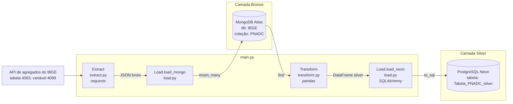

# ETL PNADC — IBGE

Pipeline ETL em Python que extrai dados da **PNAD Contínua** pela API do IBGE e leva até dois bancos na nuvem, seguindo a ideia de camadas **Bronze → Silver**:

- **Bronze** — JSON bruto, exatamente como veio da API, salvo no **MongoDB Atlas** (banco `IBGE`, coleção `PNADC`).
- **Silver** — série limpa e tipada, salva no **PostgreSQL (Neon)**, pronta para consulta e análise.

## Arquitetura



Versão em texto (para onde o Mermaid não renderiza):

```
 API do IBGE              MongoDB (Bronze)              Neon/Postgres (Silver)
┌──────────────┐        ┌──────────────────┐          ┌──────────────────────┐
│ tabela 4093  │─Extract▶│  IBGE            │─Transform▶│ Tabela_PNADC_silver  │
│ variável 4099│(requests)│  └ PNADC        │ (pandas)  │                      │
└──────────────┘        └──────────────────┘          └──────────────────────┘
```

### Fluxo

1. **Extract** — [src/extract.py](src/extract.py) chama a API de agregados do IBGE com `requests` e devolve o JSON.
2. **Load Bronze** — [src/load.py](src/load.py) `load_mongo` insere o JSON na coleção `PNADC` com `insert_many`.
3. **Transform** — [src/transform.py](src/transform.py) lê a coleção bronze do Mongo e:
   - monta um DataFrame com a série (`periodo`, `valor`);
   - troca o marcador `...` (dado indisponível no IBGE) por `0` e converte `valor` para `float`;
   - cria as colunas `ano` e `tri`;
   - converte `periodo` (ex.: `202401`) para a data de início do trimestre.
4. **Load Silver** — `load_neon` grava o DataFrame no Postgres com `to_sql` (`if_exists="replace"`).

## Dados

| Item | Valor |
|---|---|
| Fonte | [API de agregados do IBGE](https://servicodados.ibge.gov.br/api/docs/agregados?versao=3) |
| Pesquisa | PNAD Contínua trimestral |
| Tabela / variável | 4093 / 4099 |
| Localidade | Pernambuco (`N3[26]`) |
| Período | 1º trimestre de 2012 ao 2º trimestre de 2026 |
| Classificação | Sexo (`2[all]`) |

Tabela silver (`Tabela_PNADC_silver`):

| Coluna | Tipo | Conteúdo |
|---|---|---|
| `periodo` | data | Início do trimestre (ex.: `2024-01-01`) |
| `valor` | float | Valor da variável no trimestre |
| `ano` | texto | Ano (ex.: `2024`) |
| `tri` | inteiro | Trimestre (1 a 4) |

> **Atenção:** a transformação atual usa só a primeira série retornada pela API (`resultados[0]["series"][0]`). As demais categorias da classificação ficam apenas na camada bronze.

## Estrutura do projeto

```
Projeto_EngDados-/
├── main.py              # orquestra o ETL
├── requeriments.txt     # dependências
└── src/
    ├── .env             # credenciais (NÃO versionar)
    ├── extract.py       # classe Extract   → chama a API do IBGE
    ├── transform.py     # classe Transform → bronze (Mongo) → silver (DataFrame)
    └── load.py          # classe Load      → grava no Mongo e no Neon
```

## Como rodar

### 1. Ambiente e dependências

```bash
python -m venv .venv
# Windows
.venv\Scripts\activate
# Linux/macOS
source .venv/bin/activate

pip install -r requeriments.txt
```

Dependências: `requests`, `pandas`, `pymongo`, `python-dotenv`, `sqlalchemy`, `psycopg2-binary`, `certifi`.

### 2. Variáveis de ambiente

Crie o arquivo `.env` com:

```env
MONGODB_uri=mongodb+srv://<usuario>:<senha>@<cluster>.mongodb.net/
DATABASE_URL=postgresql://<usuario>:<senha>@<host>.neon.tech/<banco>?sslmode=require
```

- `MONGODB_uri` — string de conexão do MongoDB Atlas (camada bronze).
- `DATABASE_URL` — string de conexão do Neon (camada silver).

### 3. Executar

Na raiz do projeto:

```bash
python main.py
```

Saída esperada:

```
Os dados foram extraidos com sucesso!
Dados inseridos com sucesso na coleção 'PNADC'!
Os dados foram carregados com sucesso!
dados transformados em silver!
Dados salvos no Neon com sucesso na tabela'Tabela_PNADC_silver'!
```

## Próximos passos

- Tornar a carga bronze **full refresh** (hoje cada execução insere um novo documento na coleção).
- Orquestrar o pipeline com **Prefect**.
- Levar as demais categorias da classificação para a camada silver.
